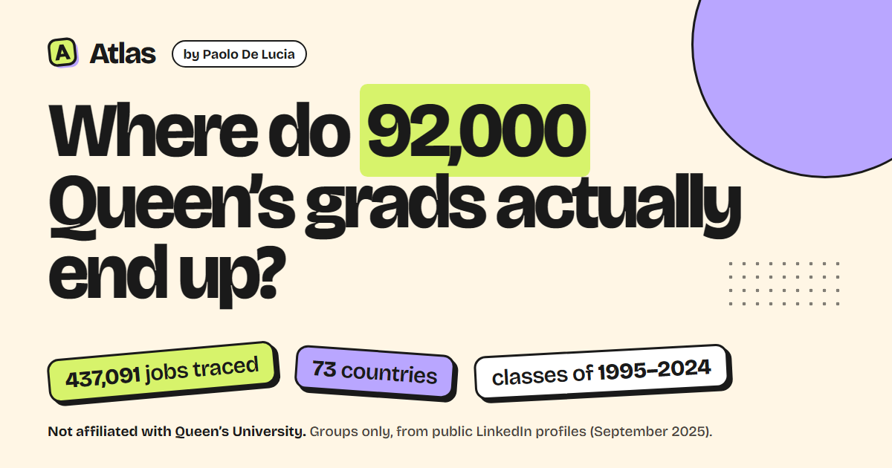
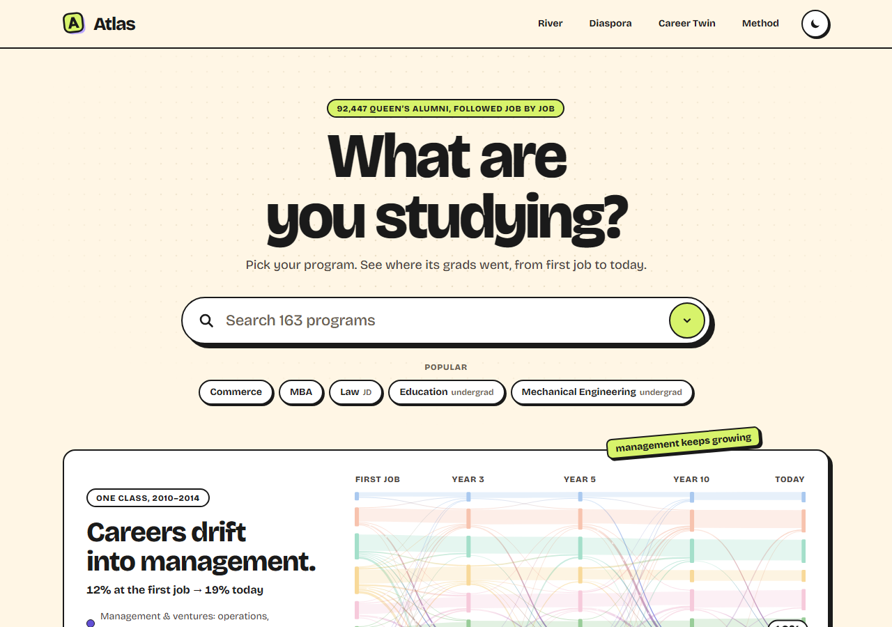
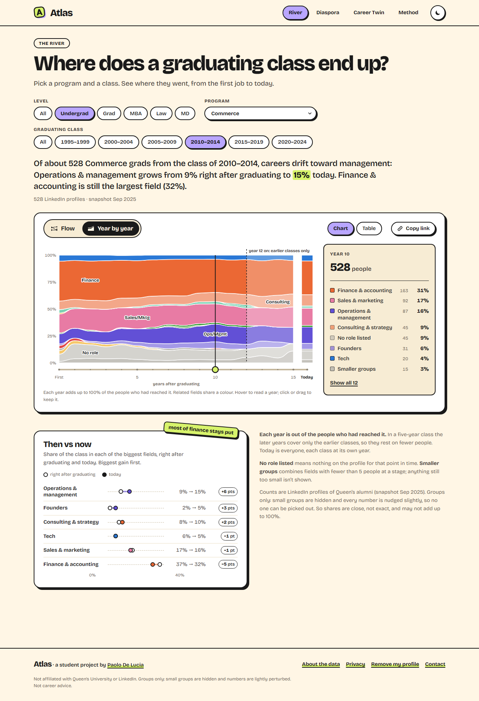
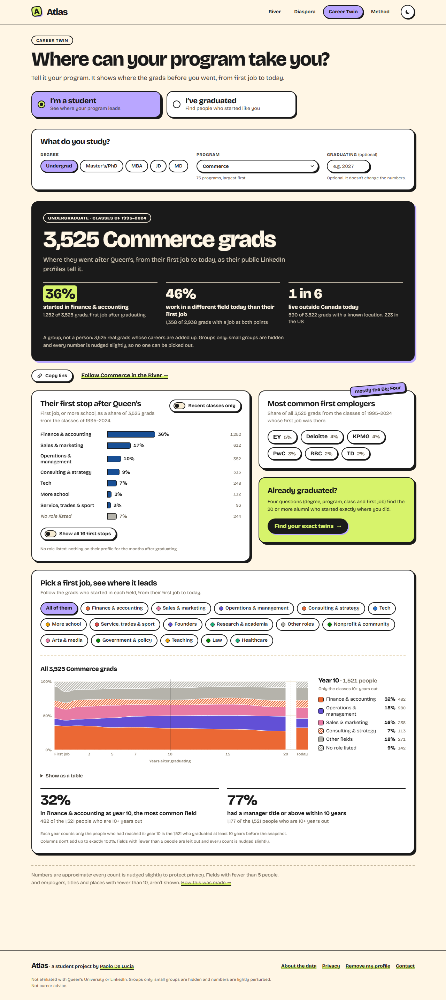
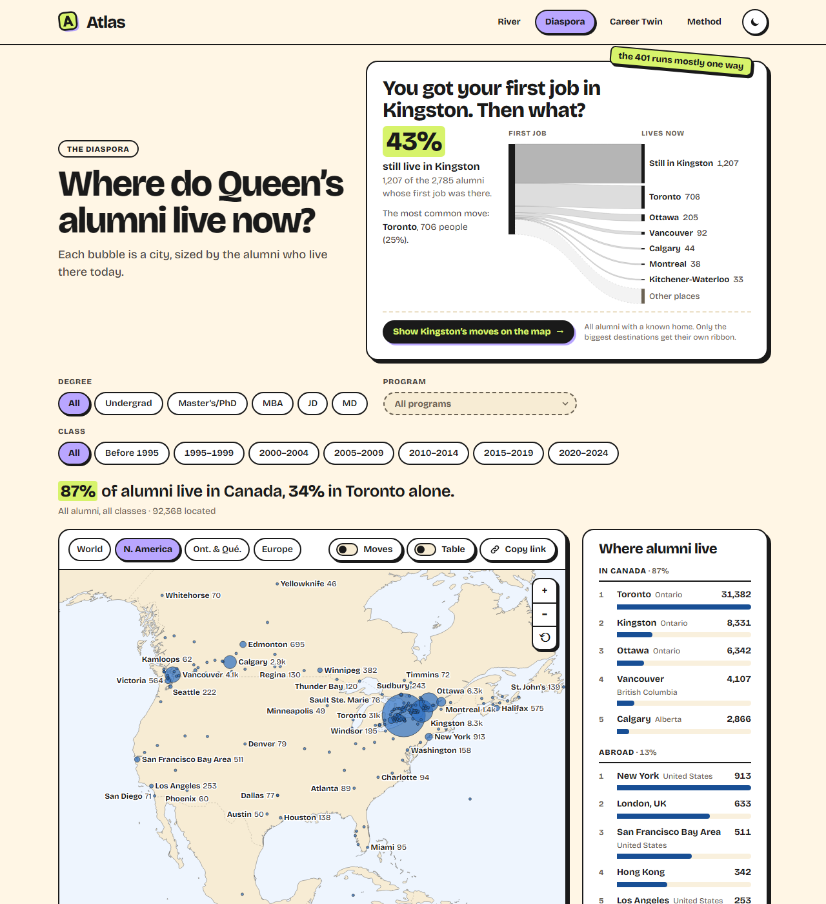
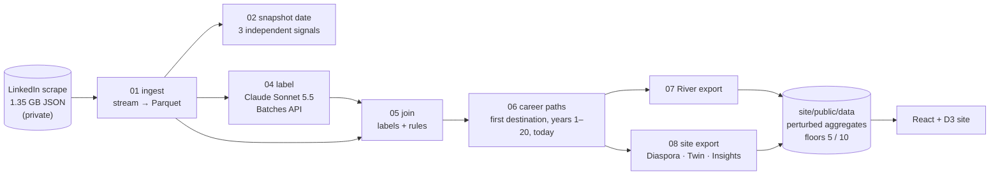

# Atlas

**Where do 92,000 Queen’s grads actually end up?** A student project by
[Paolo De Lucia](https://paolodelucia.com), built from a September 2025 snapshot of 95,020 public
LinkedIn profiles: what each program’s grads do first, where they are every year for twenty years
after, and where in the world they live now.



> Not affiliated with Queen’s University or LinkedIn. Groups only: no individual is shown. Every
> number counts at least 5 people, and at least 10 when it names an employer, a job title or a
> place, and every number is nudged slightly. Not career advice.

| | |
|---|---|
| **Home** | “What are you studying?” Search 163 programs, then jump to where that program’s grads went. |
| **The River** | Pick a program and a five-year class. *Flow* is a Sankey from the first job through years 3, 5, 10 and 20 to today; *Year by year* is a stacked chart of every year after graduating. A then-vs-now card sums up what changed. |
| **The Diaspora** | A map of where 92,000 alumni live now, a Kingston card (“You got your first job in Kingston. Then what?”), and moves from the city of the first job to the city of today. |
| **Career Twin** | For students: tell it your program and see where the grads before you went, from first job to today, and where each first job led. For alumni: four questions find the 20+ people who started where you did. |
| **Method** | How it was made: dating an undated snapshot, labelling 190k job titles, the privacy model, and every known limitation. |

<p>
  
  
</p>
<p>
  
  
</p>

## Where the data comes from

A third-party dataset of public LinkedIn profiles of people who list Queen’s University, compiled by
a commercial data provider in September 2025. I didn’t scrape LinkedIn myself, the raw data is not
in this repository and is never redistributed, and nothing on the site identifies an individual.
To have your profile excluded, or to raise a concern, email paolo.delucia@queensu.ca.

## Some things it found

- **37%** of Commerce grads from the classes of 2010–2014 started in finance or accounting, overwhelmingly at the Big Four and the banks.
- **78%** of Queen’s Law grads are still practising law ten years out; **66%** of grads who started in consulting had left it by year 10.
- **1 in 3** alumni live in the Toronto area; **13%** live outside Canada, and New York is home to more alumni than Hamilton or London, Ontario.
- **43%** of grads whose first job was in Kingston still live there; Toronto is the most common move (25%).
- **Queen’s itself** is the single most common first employer for the classes of 2015–2024.

## How it works



1. **Ingest** (`pipeline/01_ingest.py`): streams the 1.35 GB JSON array with `ijson` into Parquet
   (people, education, positions, activity) in ~25 s, parsing LinkedIn’s date strings into `YYYYMM`.
2. **Dating the scrape** (`02_snapshot_date.py`): the file had no timestamp, so three independent clues
   pin it to **September 2025**:
   - **"Present" arithmetic:** LinkedIn shows "Jan 2025 – Present · 9 months", so start + duration − 1
     is the month the page was viewed. 83% of 24.3k current roles say September 2025.
   - **Activity IDs:** these are snowflakes, and `id >> 22` gives the post time; the newest is
     2025‑09‑29 20:52 UTC.
   - **Export file name:** its base‑36 prefix decodes to 2025‑09‑30 02:26 UTC.
3. **Labelling** (`04_label.py`, `label_spec.py`): instead of 95k profiles, Claude labels each
   *distinct string* once, using structured outputs. That covers 189,821 job titles (function,
   seniority, canonical title), 20,350 employers (industry, parent company), 12,046 fields of study
   (canonical program) and 8,052 locations (city, metro, country, coordinates). Total API cost:
   **$65**. A pilot measured per-request cost before the batch was submitted.
4. **Rules** (`05_join.py`):
   - Ambiguous titles ("Associate", "Partner") take their function from the employer’s industry.
   - Side roles (boards, volunteering, clubs) never count as a job.
   - Degree levels are parsed from free text, and undergrad business variants collapse into Commerce.
   - About 460 Queen’s University **Belfast** grads that the scrape picked up by name are detected and
     excluded: they live in Northern Ireland, have no Canadian job, and no Kingston-specific school.
5. **Career paths** (`06_paths.py`): each Queen’s credential gets a career family at every point
   from graduation to the snapshot.

   | Point | Definition |
   |---|---|
   | First destination (year 0) | first real job after graduating (within 3 years), or **further study** if another degree came first |
   | Year 1 … Year 20 | the main job held in June of the Nth year after graduating (the most recently started one if several overlap); else **further study** if another degree was under way; else *no role listed*. Years 3, 5, 10 and 20 also keep the role’s employer, title and seniority |
   | Today | the main job at the snapshot (Sept 2025) |

   A year is blank (not *no role listed*) when its June falls after the snapshot: a 2018 grad
   has years 1–7. Years 5 and 10 are the old “year 5 / year 10” stages, under the same rule.

   **Cohorts.** River and Career Twin group graduates into five-year classes: 1995–1999,
   2000–2004, 2005–2009, 2010–2014, 2015–2019 and 2020–2024, plus all of 1995–2024. The River
   starts at 1995 because earlier grads’ profiles rarely list their early careers (over 40% have
   no first destination, against 6–9% for 2005–2024). The Diaspora adds everyone before 1995
   (where people live doesn’t depend on early-career data); 2025 grads appear only in its
   “all classes” view.

   **The River’s two views of a class.** The Sankey has a column for each of years 3, 5, 10 and
   20 that *every* member of the class has reached, so 1995–2004 classes get all four,
   2005–2014 stop at year 10, 2015–2019 at year 5, and 2020–2024 go straight from first
   destination to today. The year-by-year trajectory goes further: each year is counted over
   the members who have reached it, and is published with that denominator. In a five-year
   class, later years cover the earlier graduates only (year 8 of the 2015–2019 class is the
   classes of 2015–2017), so shares are always of that year’s own total. A year is shown once
   at least 10 members have reached it. Career Twin keeps years 0, 1, 2, 3, 5, 7, 10, 15, 20 and
   today, with the same numbers as the River for the same people.
6. **Exports** (`07_export_river.py`, `08_export_site.py`): suppressed, perturbed JSON for each
   view, with a self-check that refuses to write a count under its floor.

## Privacy by design

- The raw scrape and every per-person table live in `data/`, which is **gitignored**, and never
  leave the author’s machine. The repository holds only code and published aggregates.
- **Small groups are suppressed**, with two floors (`pipeline/sdc.py`):
  - **5 people** for counts by career field or state: River families and flows, the
    year-by-year trajectory, Twin outcomes, seniority, time to manager, the share abroad.
  - **10 people** for anything that names an organisation, a job title or a place: employer and
    title lists, every metro, country and move on the Diaspora map, the Kingston figures.
  - Smaller career families fold into “smaller groups”; flows under the floor are dropped;
    scalars under it are published as `null`.
  - Separately, a River class needs 30 people, a Career Twin group 20, a Diaspora filter 50
    and a leaderboard entry 100; a year on a year-by-year chart is shown once 10 people have
    reached it. These keep the charts meaningful.
- **Every published count is perturbed** with the cell-key method used by the Australian Bureau of
  Statistics (`pipeline/sdc.py`):
  - Each person has a secret random key, and each count gets noise of −2…+2 picked by the sum of its
    members’ keys (0 for 40% of counts, ±1 for 40%, ±2 for 20%). The same set of people always
    gets the same noise, in every file.
  - Without it, an independent audit showed hidden groups of 1–9 people could be recovered exactly by
    subtracting published numbers (e.g. a class total minus its cohorts). With it, no hidden cell can
    be recovered with certainty. `tests/test_sdc_differencing.py` re-runs those attacks on synthetic
    data.
  - Suppression decisions use the true counts. Published values never go below their floor (5 or
    10), and numbers may not add up exactly.
- Career Twin matches a visitor to a **group** of at least 20 alumni, never to a person. Groups
  under 50 are labelled as small.
- `tests/test_site_data_privacy.py` scans every published JSON for:
  - person-like keys, URLs and emails;
  - any count under its floor (deny by default: a count the scanner doesn’t know must reach 10);
  - (locally) any string that exactly matches a profile’s name.

## Run it

The site runs from the committed aggregates; no private data is needed.

```bash
cd site
npm ci
npm run dev          # http://localhost:5173
npm run build        # production build in site/dist (+ 404.html SPA fallback)
```

Rebuilding the data needs the private scrape in `data/raw/`:

```bash
uv venv --python 3.12 && uv pip install duckdb ijson pyarrow pandas anthropic pytest
.venv/Scripts/python pipeline/01_ingest.py          # JSON → data/processed/*.parquet (~25 s)
.venv/Scripts/python pipeline/02_snapshot_date.py   # date triangulation report
.venv/Scripts/python pipeline/04_label.py collect   # LLM labels (batches already run; see --help)
.venv/Scripts/python pipeline/05_join.py            # labels → roles + Queen's credentials
.venv/Scripts/python pipeline/06_paths.py           # career path per credential
.venv/Scripts/python pipeline/07_export_river.py    # River aggregates
.venv/Scripts/python pipeline/08_export_site.py     # Diaspora / Twin / Insights / Meta → site/public/data
```

## Tests

| Suite | What it covers | Command |
|---|---|---|
| Pipeline (pytest, ~770 tests) | parsing, labelling parse/schema, join rules through DuckDB, every career-stage and year-by-year rule on synthetic people, cohort bands, exports, determinism, cell-key perturbation, both suppression floors and differencing attacks, privacy scan | `.venv/Scripts/python -m pytest -q` |
| Site unit (Vitest, ~630 tests) | router & URL state, data loading, data-contract checks against the real JSON, each view’s model and components | `cd site && npm test` |
| End-to-end (Playwright, desktop + 375px phone) | every route renders without console errors or horizontal scroll, deep links, hostile query params, theme persistence, data outage, axe accessibility scan (WCAG 2.1 AA) of every page and the main picked states in light and dark | `cd site && npm run e2e` |

CI (`.github/workflows/ci.yml`) runs all three on every push. Pipeline tests use synthetic fixtures only.

## Repository layout

```
pipeline/           Python + DuckDB pipeline (01–08) and the labelling spec
tests/              pytest suite (synthetic data) + privacy scan of published JSON
site/               React 19 + Vite + TypeScript + D3
  public/data/      the only data the site ever sees (perturbed aggregates)
  src/data/         data contract (types.ts), taxonomy & palette, loader
  src/views/        home, river, diaspora, twin, method
  e2e/              Playwright specs
  scripts/          og-image renderer, screenshot helper, SPA fallback
data/               (gitignored) raw scrape, Parquet tables, labels, per-person paths
```

## Limitations

- **Selection bias:** LinkedIn isn’t a census. Profiles skew toward people who keep a profile
  current, which means recent grads and corporate careers.
- **Profile gaps:** “No role listed” means nothing was on the profile for that time; it doesn’t
  mean unemployed. Older grads’ early careers are sparse.
- **Label errors:** labels come from a model and deterministic rules, and some are wrong. The
  taxonomy groups 28 functions into 17 career families.
- **Geography:** locations are self-reported and geocoded to metro areas.

## Built with

Python 3.12, DuckDB, ijson, PyArrow · Claude Sonnet 5.5 (Message Batches API, structured outputs) ·
React 19, Vite 8, TypeScript, D3 (d3-sankey, d3-geo), world-atlas, Bricolage Grotesque · Vitest,
Testing Library, Playwright, axe-core.
